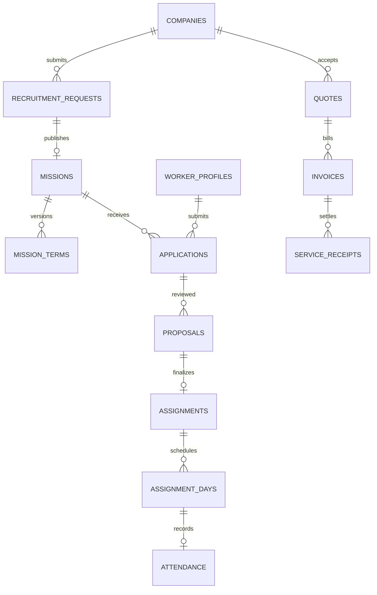

# Kazi logical database specification

## Conventions

PostgreSQL is the working baseline. Application records use UUID primary keys, created_at and updated_at as timestamptz, and integer version fields on mutable workflow aggregates. Foreign keys are explicit. All columns below are required unless marked ?. Store business codes as constrained text; add migrations before introducing new values. Monetary amounts use nonnegative bigint in currency minor units plus char(3) currency and smallint currency_exponent. XAF configuration uses exponent 0. Never use float for money or mix currencies in one quote/invoice. Country codes are char(2); dates are date; event instants UTC; each mission stores its operational timezone. Auth provider user IDs are opaque strings and must not be forced into UUID format.

This is a logical schema, not executable migrations. Auth-managed table details must be generated for the selected library version and reviewed together with application migrations. Tables are grouped by domain; service permissions apply before every query. The app database is not exposed directly to browsers. PostgreSQL RLS may add defense in depth if correctly integrated with connection/session scope, but is not a substitute for service authorization; do not claim it exists unless implemented and tested.

## Identity and scope

| Table | Essential columns and relations |
| --- | --- |
| auth_user/session/account/verification | Provider-managed IDs, sessions and credential/verification records; no raw OTP or password in application tables |
| worker_profiles | id uuid, user_id text unique FK auth_user, country_code, display_name text, trade_codes text[], area_code text, experience_text text?, availability_code text, profile_status text |
| user_preferences | id, user_id text unique FK auth_user, notification_preferences jsonb validated to approved keys, preferred_locale text, version int |
| companies | id, country_code, legal_name text, registration_reference text?, area_code text, address text?, contact_email text, verification_status text, version int |
| company_memberships | id, company_id FK, user_id text FK auth_user, role text OWNER, status text; unique company/user; one active OWNER per company in v1 |
| staff_grants | id, user_id text FK auth_user, country_code, capability text, status text, version int; unique user/country/capability |
| verification_documents | id, company_id? FK, worker_profile_id? FK, object_key text unique, file_name text, mime_type text, size_bytes bigint, scan_status text, review_status text, reviewed_by? text, review_reason? text, retention_until? timestamptz |

Document owner is exactly one company or worker, enforced by a check. Visibility is staff review plus submitting owner as appropriate, not other companies. Identity-check status and experience claims are distinct. Required document types and retention remain reviewed country policy, not arbitrary free-form automation.

## Recruitment and mission delivery

| Table | Essential columns and relations |
| --- | --- |
| recruitment_requests | id, company_id FK, country_code, trade_code text, headcount int, proposed_terms jsonb, status text, submitted_by text, reviewed_by? text, review_reason? text, version int |
| missions | id, request_id FK unique, company_id FK, country_code, current_terms_id? FK, status text, version int |
| mission_terms | id, mission_id FK, revision int, trade_code text, title text, description text, site_name text, area_code text, site_address text, headcount int, pay_amount bigint, pay_currency char(3), currency_exponent smallint, pay_unit text DAY, payment_timing text, payment_method text, equipment_text text, timezone text, starts_at/ends_at timestamptz, schedule_summary text; unique mission/revision |
| mission_days | id, terms_id FK, local_date date, starts_at/ends_at timestamptz, break_minutes int; unique terms/local_date |
| applications | id, mission_id FK, worker_id FK worker_profiles, terms_id FK, status text, submitted_at timestamptz, withdrawal_reason? text, version int; unique mission/worker |
| proposals | id, application_id FK, terms_id FK, proposed_by text, company_decision text, worker_decision text, company_decided_at? timestamptz, worker_decided_at? timestamptz, expires_at? timestamptz, status text, version int |
| assignments | id, proposal_id FK unique, mission_id FK, worker_id FK, terms_id FK, status text, confirmed_by text, confirmed_at timestamptz, supersedes_assignment_id? FK assignments, cancellation_reason? text, version int |
| assignment_days | id, assignment_id FK, mission_day_id FK, worker_id FK, starts_at/ends_at timestamptz, coverage_status text; unique assignment/mission_day |
| attendance | id, assignment_day_id FK unique, declared_status text, worked_minutes int?, declared_by? text, declaration_revision int, worker_decision text, worker_confirmed_revision? int, resolution_status text, resolved_by? text, reason? text, version int |
| attendance_events | id, attendance_id FK, actor_id text, event_code text, previous_value? jsonb, new_value jsonb, event_at timestamptz; append-only |
| replacement_requests | id, original_assignment_id FK, requested_by text, reason_code text, status text, replacement_assignment_id? FK, note? text, version int |
| replacement_days | replacement_request_id FK, assignment_day_id FK; composite PK |

Recruitment request proposed_terms is a validated prepublication form, not an untyped schema for arbitrary execution. Published terms use typed immutable columns. Public APIs redact precise contact/site details where required; confirmed workers receive the meeting-point data appropriate to the mission. Coarse area remains discoverable.

Enforce headcount>0, ends_at>starts_at, worked_minutes>=0 and no more than the approved daily duration absent an explicit correction. An assignment must point to the same mission/worker as its proposal/application; enforce through composite constraints where possible plus transaction validation. No two active confirmed coverage intervals overlap for one worker. Implement a PostgreSQL exclusion constraint over worker_id and time range on active assignment_days, or an equivalently tested transaction/lock design; serialize schedule changes by worker, then lock the mission in a stable order. Active capacity is counted for each mission day/terms interval. Tests must demonstrate last-slot and replacement concurrency safety. Do not implement only a UI capacity check.

## Commercial and support records

| Table | Essential columns and relations |
| --- | --- |
| quotes | id, company_id FK, mission_id? FK, country_code, revision int, status text, currency/exponent, service_amount bigint, tax_amount bigint, total_amount bigint, commercial_snapshot jsonb, expires_at timestamptz, accepted_by? text, accepted_at? timestamptz, version int |
| invoices | id, quote_id FK, company_id FK, country_code, invoice_number text unique, status text, currency/exponent, subtotal_amount bigint, tax_amount bigint, total_amount bigint, party_tax_snapshot jsonb, issued_at? timestamptz, due_at? timestamptz, version int |
| invoice_lines | id, invoice_id FK, description text, quantity int, unit_amount bigint, tax_amount bigint, line_total bigint |
| service_receipts | id, invoice_id FK, amount bigint, currency/exponent, external_reference text, received_at timestamptz, recorded_by text, reverses_receipt_id? FK unique, note? text; unique invoice/external_reference |
| support_cases | id, country_code, company_id? FK, worker_id? FK, mission_id? FK, assignment_id? FK, reporter_user_id text, category text, status text, assigned_staff_id? text, version int |
| case_messages | id, case_id FK, author_id text, visibility text PUBLIC_TO_CASE or STAFF_ONLY, body text, event_at timestamptz |
| notifications | id, user_id text, event_id uuid, template_key text, payload jsonb, read_at? timestamptz; unique user/event/template |
| outbox_events | id, event_key text, aggregate_id uuid, payload jsonb, status text, attempt_count int, next_attempt_at timestamptz, leased_until? timestamptz, delivered_at? timestamptz |
| provider_events | id, provider text, provider_event_id text, verified_at timestamptz, processed_at? timestamptz; unique provider/event ID |
| audit_events | id, actor_id? text, country_code, company_id? uuid, action text, entity_type text, entity_id text, redacted_change jsonb, request_id text, occurred_at timestamptz; append-only |
| idempotency_records | id, actor_scope text, route_key text, idempotency_key text, request_hash text, response_code int, response_body jsonb, expires_at timestamptz; unique actor/route/key |
| configuration_activations | id, country_code, activation_revision bigint, config_version text, theme_id text, activated_by text, reason text, activated_at timestamptz; unique country/activation_revision; immutable history |

Receipt corrections are compensating entries, never edits of past receipt amounts. A reversal references exactly one original receipt on the same invoice, with the same positive amount and currency; a receipt can be reversed only once and reversals cannot be reversed in v1. Paid balance is original receipt totals minus valid reversal totals. Validate total balances and quote/invoice matching in transactions. Snapshot invoice details on issue; subsequent profile, theme or country updates do not rewrite invoices. Themes are files/registries; configuration_activations stores pointers/history, not arbitrary executable CSS or formulas. Activation revision starts at 0 from the packaged registry. Serialize each country activation, compare expectedActivationVersion to the latest revision, and append the next revision atomically so concurrent administrators cannot lose an update.

## Relations overview

## Query indexes and lifecycle

Index published missions by country/status/start time and area/trade; requests by company/status/created_at; applications by worker/created_at and mission/status; proposals by mission through application and decision/expiry; assignment_days by worker/start and mission relation; support by scope/status/updated_at; invoices by company/status/due_at; outbox by status/next_attempt_at; audit by country/occurred_at. Add unique constraints before relying on idempotency. Avoid indexes without a real query.

Use versioned migrations and synthetic seeds: two companies, one recruiter, one finance user, one administrator, workers in varied states and missions with capacity/overlap conflicts. Back up database and objects with a documented restore test. Retention/deletion is policy-controlled, not cascading removal of attendance, audits or invoice records. Suspend access promptly; anonymize removable data only after an approved retention review, preserving required references without asserting a legal retention period in this document.
