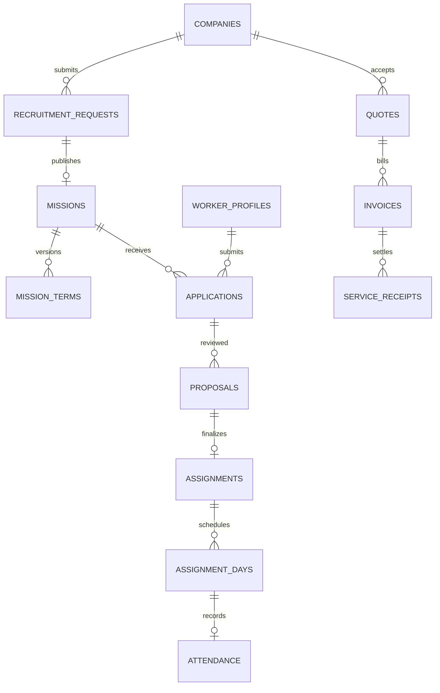

# Kazi master agent playbook

Specification edition 2.0.0. Product target 1.0.0. Prepared 23 November 2026.

Use this single reading file OR the separate specifications. The ZIP also contains the machine-readable configuration, fixtures and validator. Follow START_HERE and AGENTS. This is a design-first execution brief, not an implemented application.


---

Source file START_HERE.md

# Start the Kazi project here

Specification edition: 2.0.0. Target first product release: 1.0.0. Prepared 23 November 2026.

This is the execution brief for the agent. It supersedes the earlier generic prompt playbook for new Kazi work. It contains product decisions and engineering defaults, not evidence that a product has already been built or approved for launch. An owner instruction always takes precedence. Record material departures in DECISIONS.md and update affected specifications together.

## Give this instruction to your agent

Read AGENTS.md, PRD.md, DESIGN.md, THEMING_AND_COUNTRIES.md, WORKFLOWS.md and IMPLEMENTATION_PLAN.md before changing files. Inspect any existing repository and preserve working code. Begin at phase D0, premium UI/UX, for Kazi's Gabon launch. Create the screen inventory, reusable token-based components and a local interactive prototype covering worker, company and administration journeys, using synthetic data. Compare the supplied Gabon and alternative themes. Do not implement live authentication, a production database, payroll, real notifications or deployment at this stage. Verify responsive layouts, accessibility, states and theme switching. Produce a design handoff with review links or file paths, what was checked and unresolved decisions. Keep the same domain rules under both themes. Continue within D0 until its reviewable deliverables are complete; owner acceptance of the design is the boundary before D1 implementation. Do not ask about routine styling or reversible implementation choices that the documents already answer.

## Reading and file placement

If adding this pack to an existing repository, merge AGENTS.md instructions with any existing file; do not overwrite repository-specific rules silently. Keep AGENTS.md at repository root and copy the remaining documents and config under docs/kazi, updating relative references if moved. Until then, all paths in this pack are relative to this directory. Do not paste the master document and the individual copies together into an agent context; choose either format.

| File | Purpose |
| --- | --- |
| PRD.md | Product scope, roles, requirements and acceptance criteria |
| DESIGN.md | Premium UI/UX specification and screen guidance |
| THEMING_AND_COUNTRIES.md | Theme, locale, country and future change contracts |
| WORKFLOWS.md | State transitions and business invariants |
| ARCHITECTURE.md | Working technical baseline for the implementation stage |
| DATABASE.md | Logical tables, constraints, access and migration rules |
| API.md | API contracts, actions, failure handling and permissions |
| AGENTS.md | Rules applied to every agent task |
| IMPLEMENTATION_PLAN.md | Ordered, verifiable work and design acceptance gate |
| QA_AND_RELEASE.md | Test matrix, release checks and rollback |
| VERSIONING.md | Independent product, theme, config and schema versions |
| OPERATIONS_AND_SECURITY.md | Access controls, services and operational procedures |
| DECISIONS.md | Explicit defaults, deferred decisions and launch dependencies |
| AGENT_WORKFLOWS.md | The original 20 delivery stages made project-specific |
| VALIDATION.md | Checks actually run on this pack and their limits |
| SOURCES.md | Official technical references to recheck before setup |
| config | Versioned theme presets and Gabon country manifest |
| scripts/validate_pack.py | Dependency-free checks for the supplied pack |
| MASTER_PLAYBOOK.md | The same specifications in a single reading file |

## Definition of a successful handoff

The agent can begin D0 without inventing the business model, deciding who selects candidates, hardcoding country colors, choosing a live provider, or re-creating the project specification. Run `python3 scripts/validate_pack.py` from the pack root to check configuration integrity. This validates the documents and configuration only; it does not test an application that does not yet exist.


---

Source file AGENTS.md

# Kazi agent instructions

## Immediate mode

Default mode is DESIGN_ONLY, phase D0. Complete UI/UX deliverables first. This pack authorizes design artifacts and local prototype work, not a live launch. Later phases require the owner's instruction to proceed. Deliver concrete reviewable work before seeking an acceptance decision. Do not treat every routine choice as a permission gate.

## Source of truth

Read START_HERE.md and the relevant specifications. Owner instructions prevail. Preserve PRD business invariants and WORKFLOWS state rules over illustrative mockups. Machine-readable country/theme values in config are authoritative over duplicated palette examples; validate them against DESIGN and THEMING_AND_COUNTRIES. ARCHITECTURE applies to implementation after design acceptance. Record a conflict and resolve only the dependent work; continue independent work. Do not manufacture approval or missing credentials.

## Nonnegotiable product boundaries

Workers never pay recruitment fees. Companies pay workers directly. Kazi invoices only its own recruitment service. Kazi staff perform selection; company approval is separate from worker confirmation. An accepted proposal is not an assignment. Never allow a visual theme, country selector or feature flag to bypass these rules or server authorization. No public signup grants staff privileges.

## Engineering conduct

Inspect existing files, dependencies and tests before editing. Reuse components, services and conventions. Keep TypeScript strict; no unexplained any or suppressed errors. Separate presentation, validation, domain services and persistence. Client components cannot import private database or provider modules. Use shared runtime validation at boundaries. Use semantic tokens, translation keys and formatters; no raw brand colors or Gabon-specific branches in page components. Icons have labels where needed.

Add dependencies only for a clear need; prefer established libraries, pin actual resolved versions and commit a lockfile. Do not assume an installed framework matches a future documentation example. Keep one product with modular services, not country-specific forks or premature microservices. Preserve minimal vertical slices and focused diffs. Never rewrite unrelated code or silently alter a schema or contract.

## Security and changes

Every protected service checks identity, role, country and company or worker scope. Never trust a requested companyId without membership authorization. Private verification documents and staff notes are not company candidate data. Do not log OTPs, credentials, document contents or full phone numbers. Use synthetic data in design, tests and demos. No production secret, deployment, real SMS, invoice dispatch, deletion or destructive migration without the relevant operational authorization.

Use migrations for database changes and transactions for business transitions. Make externally retried actions idempotent. Preserve audit records and financial history. Do not run the original 20 stage instructions as a single automatic batch. Optional MCP integrations are development tooling, not a prerequisite for Kazi.

## Verification and reporting

For each task report goal, changed files, checks actually run, failures, limitations and next task. Run meaningful affected checks. Test role and tenant boundaries, state transitions and concurrency before treating the recruitment loop as complete. Include loading, empty, error, success, permission-denied and offline/retry states. For UI, inspect 360, 768 and 1440 px layouts and both provided themes. A passing token check does not imply WCAG conformance or application readiness. Do not claim code is implemented, deployed, approved or tested without evidence.

## Workflow continuity

Maintain a progress note with current phase, completed requirement IDs, unresolved issues, next task and verification evidence. Update it before a handoff or interruption. Retain a CHANGELOG and ADR-style entries in DECISIONS.md. Theme-only work must not introduce auth, database or recruitment-flow changes.


---

Source file PRD.md

# Kazi product requirements

## Purpose and launch context

Kazi connects companies needing temporary daily labor with workers seeking short assignments. It provides human-assisted recruitment and mission follow-up, not payroll or guaranteed employment. Launch country is Gabon (GA); initial area is Libreville and owner-approved nearby areas. Initial UI is French, currency XAF and operational timezone Africa/Libreville. Availability outside enabled areas is not promised. English is used in engineering documents.

Product target is 1.0.0. This pack supplies a concrete working baseline so the agent can proceed with design. Commercial, legal and live-provider decisions remain owner responsibilities, as listed in DECISIONS.md.

## Users and permissions

| Role | Can do | Cannot do |
| --- | --- | --- |
| Visitor | Browse public summaries of published missions | Access identities, applications or private company data |
| Worker | Manage own profile, apply, withdraw, decide availability, view own assignments, report issues | Select candidates, approve for a company, edit confirmed attendance or read other workers' data |
| Company owner | Maintain own company, submit requests, review its proposed profiles, approve/decline, declare attendance, view its invoices | Search the full worker directory, read private IDs/internal notes or another company's data |
| Recruiter | Review companies/requests, verify relevant data, select, propose, assign, coordinate replacements and follow up | Grant staff roles, alter financial history or access other country scopes without a grant |
| Finance | Manage Kazi quotes/invoices and record verified external receipts | Change selection, see identity documents without a separate grant or charge workers |
| Administrator | Manage authorized team roles, country/theme activation, audit and exceptional operations | Bypass audit, change business invariants through branding settings or erase history silently |

Staff permissions are capabilities, not a client-supplied role string. One account may be a worker and company member; changing workspace never changes authorization. V1 exposes one company owner membership per company; additional team invitations are deferred, but schema accommodates memberships. Staff can hold recruiter and finance capabilities if explicitly assigned.

## Commercial model

Workers pay no recruitment fee. The company pays worker remuneration directly under agreed terms, displayed before application and copied to the assignment. Kazi's service fee is agreed with the company using a quote, then invoiced separately. There is no fixed percentage or flat fee in the product baseline. Illustrative amounts are fixtures, not public tariffs. A remuneration estimate is never a receipt. Tax identity, required invoice fields and tax treatment must be approved before real invoice issuance.

## Core requirements and acceptance

| ID | Requirement | Acceptance criterion |
| --- | --- | --- |
| KZ01 | Worker access and profile | Verified identity channel; own name, skills, zone and availability editable; no fee collected |
| KZ02 | Company registration/review | Owner supplies company fields and required approved documents; staff can approve or request corrections |
| KZ03 | Staffing requests | Company supplies trade, headcount, site, dates, schedule, pay and equipment; submitted need is reviewed |
| KZ04 | Publication | Only authorized recruiter publishes a reviewed request with a verified company and complete terms |
| KZ05 | Discovery | Visitor/worker sees published missions in enabled country; filters trade, area and start date |
| KZ06 | Applications | Worker applies once per mission; duplicate, closed mission and suspended account rejected |
| KZ07 | Human selection | Staff can shortlist and propose only eligible applicants; company sees only explicitly shared fields |
| KZ08 | Separate confirmations | Company decides on proposal and worker confirms against the same terms version; stale confirmation rejected |
| KZ09 | Final assignment | Recruiter finalizes only after both accept, capacity and date checks pass; operation is atomic |
| KZ10 | Attendance | Company declares daily presence; worker confirms/disputes own entry; recruiter resolves disagreement with history |
| KZ11 | Replacement | Either party reports absence; staff proposes a new worker through normal confirmation rules; no guarantee implied |
| KZ12 | Support | Worker/company opens scoped case; support thread supports communication with Kazi; internal notes stay private |
| KZ13 | Mission close | Staff checks attendance/bilan and resolves or explicitly links outstanding disputes before closing |
| KZ14 | Kazi service billing | Company accepts quote; finance issues invoice only when launch details complete; no salary included |
| KZ15 | Notifications | In-app notifications reflect committed events; delivery failure never reverses the business action |
| KZ16 | Configuration | Authorized admin can activate validated country/theme presets; no per-country page duplication |
| KZ17 | Accountability | Staff verification, status, theme and finance changes produce redacted audit events |

## Required screen inventory

Worker: welcome/login, phone verification, onboarding/edit profile, mission list/filter/detail, application submission/result, application list/detail, availability decision, withdrawal confirmation, assignment details, absence report, mission history/detail, support inbox/thread, issue form, notifications, settings/privacy and logout. Include invalid/expired code, incomplete profile, duplicate application, no missions, service failure, restricted account and session expiry.

Company: signup/login/recovery/reset, company profile/document status, overview, request create/draft/submit/detail/edit/cancel, validation waiting/correction, candidate proposals/detail/decision, mission roster, attendance/bilan, replacement request, support inbox/thread, quotes/acceptance, invoice detail/download and notifications/settings. Direct publication and full-directory worker browsing are excluded.

Administration: staff login/MFA/recovery, prioritized work queue, company/document review, request moderation/publication, worker search/profile/checks, application/shortlist/proposal views, confirmations/finalization, mission roster/attendance reconciliation, replacements, support case and internal notes, quote/invoice/receipt records, notification failures, authorized staff/settings, theme preview/activation and audit history.

Screens can be dialogs or reused layouts where appropriate. Do not create a new full page for each minor state. Static screenshots do not constitute a tested workflow.

## V1 boundaries

Include the requirements above with basic Kazi-mediated support, in-app notifications, manual service-fee receipt recording and a responsive web product. Exclude payroll, worker wallets, escrow, commission deduction from wages, automatic AI selection, subscriptions, instant hiring, native apps, real-time GPS, public worker ratings and company-to-worker unrestricted chat. No future country is publicly enabled merely because a theme exists.

## Quality and success

Aim for simple mobile use on constrained connections: text-first job cards, optimized optional images, progressive loading and safe retries. Target WCAG 2.2 AA. Store timestamps in UTC and render in operational locale/timezone. No state is conveyed by color alone. Require keyboard navigation and clear focus. Test worker discovery/apply/confirm, company request/approve/presence and staff review/select/finalize end to end.

Track real request-to-first-proposal time, fill rate, confirmation completion, attendance rate, repeat company usage and net service revenue separately from worker wages. Establish numeric commercial targets after a pilot; do not invent traction. Production launch requires an enabled service area, staff operations, verified communication delivery, approved policies and a completed release audit.


---

Source file DESIGN.md

# Kazi premium UI and UX specification

## Direction

Premium means legibility, calm hierarchy, coherent behavior and dependable feedback. Use task-focused views, restrained brand accents, compact content and familiar controls. Avoid promotional banners inside operational screens, invented charts, excessive shadows, glossy icons and decorative gradients. No personal rating or opaque suitability score. Preserve dignity and accessibility for workers using basic phones or limited data.

## Design foundations

Themes and exact color values live in config/themes. Use the default Gabon candidate for first review and the alternate preset for proof of portability. All components reference semantic tokens. Font: self-hosted Manrope if licensed assets are available, with system sans-serif fallback. Do not block content loading on a font. Body/input 16px on mobile; desktop body 14-16px, supporting labels at least 12px. Heading scale 20/24/32px; use 400/500/600 weights and avoid every heading becoming a hero.

Spacing: 4, 8, 12, 16, 24, 32, 48px. Mobile page padding 16px, tablet 24px, desktop 32px. Standard control height at least 44px on touch surfaces; tables can be compact on desktop but retain usable row actions. Radii 8px inputs, 12px cards, 16px dialogs; badges may be pill-shaped. Shadows only for actual elevation. No decorative shadows on every card. Mobile content max width about 640px; desktop workspace max width 1440px with 224px sidebar, collapsible on smaller screens.

Breakpoints are layout thresholds, not device models: small below 640px, medium 640-1023px, large 1024px and above. Test 360px without horizontal page scrolling, 768px and 1440px. Complex data tables become labeled cards or a deliberately scrollable region with a visible affordance; never shrink text to force fit.

## Shared components

AppShell, WorkerBottomNav, WorkspaceSidebar, PageHeader, Button, IconButton, Field, Select, DateRange, MoneyField, OTPInput, Dialog, Alert, StatusBadge, MissionCard, CandidateRow, Timeline, AttendanceRow, DataTable, Tabs, Toast, Skeleton, EmptyState, ErrorState and FileUpload. Define default/hover/focus/pressed/disabled/loading states and keyboard behavior once. Primary button uses primary/onPrimary tokens; secondary uses neutral surface/text/controlBorder. Destructive action uses danger text, plain wording and confirmation when materially irreversible. Never hide essential actions behind hover. Disabled actions explain what is missing.

## Navigation and journeys

Worker bottom navigation: Missions, Candidatures, Messages, Profil. Notification access sits in the header. Settings and Aide remain reachable from profile and contextual screens. Mission card foregrounds trade, location, pay per day, duration and start. Detail provides tasks, schedule, equipment, wage-payment party and method/timing when approved before the Postuler action. The same job data and terms revision appear on the confirmation screen. Distinguish shortlisted/proposed/approved/confirmed; use a short timeline. A worker's successful availability confirmation still awaits Kazi final assignment; do not announce final placement early.

Company sidebar: Vue d’ensemble, Demandes, Candidats proposés, Missions, Factures and contextual Assistance. Main overview emphasizes actionable requests and profiles awaiting a decision, not fabricated performance charts. Request form can be steps: need, conditions, review; preserve unsent draft input. Label submission Envoyer à Kazi, not Publier. Candidate fields are limited to shared relevant experience, skills, zone and availability. Personal phone/identity documents and internal notes are excluded. Approval action explains worker confirmation is still required.

Administration: À traiter, Demandes, Ouvriers, Entreprises, Missions, Facturation; staff/settings only for permitted users. Use role/country-scoped queues. Candidate table supports selection with a persistent selected count and Proposer à l’entreprise. Separate identity verification from self-declared experience. Finalization shows company and worker confirmations independently, terms version and remaining capacity. Billing shows Kazi service amounts only. Theme settings show preview and separate audited activation.

## Forms and state coverage

Labels stay visible; placeholders are examples, not labels. Show required fields, inline guidance and a summary linked to invalid fields. Validate both on client and server; errors preserve input. France/Gabon phone formatting is not guessed from number length: use region-aware validation and E.164 storage. Currency inputs show XAF/FCFA and unit explicitly. Do not request CV, GPS or identity documents without the defined business need.

Every core view defines initial loading, empty, populated, permission denied, not found, recoverable error and expired session. Every mutation defines submitting, success, validation failure, stale-version conflict and network retry. Disable duplicate submits, but also rely on server idempotency. Never display success before a confirmed response. An offline confirmation remains unsent; it is not queued for silent later execution. Show Réessayer and the current known state. Do not erase typed drafts because an optional image fails.

## Accessibility and motion

Target WCAG 2.2 AA. Normal text needs 4.5:1 contrast; large text 3:1, with eligible definitions from W3C. Essential controls and focus indicators must be distinguishable; test their actual combinations. Prefer 44px touch targets as Kazi's product standard; this is not a claim that every WCAG minimum is 44px. No color-only states. All controls have names, visible focus and keyboard operation. Dialogs manage focus, close predictably and return focus. Errors use appropriate live announcements without reading every render. Respect zoom, reflow, reduced motion and text scaling. Use subtle 120-180ms transitions for feedback, with reduced-motion alternatives; no looping decorative animation.

## Design delivery acceptance

Deliver a screen inventory linked to KZ IDs; worker apply-to-confirm flow; company request-to-approval flow; administration review-to-assignment flow; basic attendance/replacement/support/billing states; reusable component samples; both theme previews; responsive variants; and an accessibility/state checklist. Include empty, error and permission examples rather than only perfect screenshots. A local click-through can use synthetic fixtures; it must be labeled as a prototype. Usability review should include users representative of workers, company coordinators and recruiters before production implementation proceeds.


---

Source file THEMING_AND_COUNTRIES.md

# Themes and country configuration

## Independent concerns

A product release, a visual theme, a country configuration, a translation catalog and a database migration are different artifacts. Gabon is the launch country, not a conditional branch inside every page. A theme update must not rename statuses, change payroll behavior or rebuild a database. A country launch needs operational approval even if its theme is already tested.

Default country GA uses fr-GA, XAF, Africa/Libreville and calling prefix +241. Launch country configuration enables Libreville as the initial area only; expansion is an explicit configuration change. Resolve country from the authorized workspace or explicit public market selection. Never use a flag, IP address or browser locale as proof of legal eligibility, membership or authorization.

The default design candidate is gabon-premium@1.0.0: deep green actions, warm surfaces, restrained gold accents and blue information styling. This is a Kazi brand proposal inspired by the launch context, not an assertion of official national flag color codes. The previous forest/orange direction is retained as forest-premium@1.0.0 for comparison and regression checks. Owner visual acceptance is still part of D0. No later palette or next product release is promised.

## Token contract

Components consume semantic names only: color.background, surface, text, textMuted, border, controlBorder, primary, onPrimary, primaryHover, accent, onAccent, infoSurface, infoText, successSurface, successText, warningSurface, warningText, dangerSurface, dangerText, focusRing, focusRingOnDark, sidebar and onSidebar. Primitive hex values exist only in versioned theme files, generated CSS artifacts and theme tests; colors inside country flags or photography are not application semantic colors.

Typography, spacing, radius, motion and breakpoints belong to the same design contract but are independent of country. Start with the design values in DESIGN.md. Generate CSS custom properties such as --color-primary from validated config. Component CSS references those properties. Charts, email templates, PDFs, dialogs, placeholders and third-party components need the same semantic mapping. Server-rendered and client-hydrated theme IDs must agree. Cache assets by immutable theme ID/version, not by a mutable country name.

Use dedicated status tokens and a visible label or icon. Do not change all status colors when the brand changes. Decorative borders can be subtle; essential input boundaries use controlBorder. Outline/focus visibility must be tested on the actual surrounding background. Never place white small text on the legacy orange primary; that preset explicitly pairs it with dark text.

## Resolution and authorization

For an authenticated workspace: read its countryCode from authorized data -> resolve the active country configuration version -> resolve its explicit defaultThemeId -> load that exact registered immutable theme -> map semantic keys. A prototype-only theme preview overrides presentation for that preview, not persisted membership/country or server policy. Public pages default to GA when no enabled market is selected. Do not implement arbitrary remote CSS, user-supplied tokens or database-driven executable expressions.

Production supports only registered validated themes. Preview can be local or available to authorized staff; preview must be clearly marked. Activation is a privileged administrator action, audited with old/new theme/config versions and reason. Deploy theme assets first, validate, then update the configuration pointer. If a theme is missing or invalid, use last-known-good config; if none exists, fall back to packaged GA baseline for visual rendering and raise an operational alert. Do not silently route an unsupported country to a GA business workflow.

## Safe palette change procedure

1. Duplicate a theme file with a new immutable version or ID; never edit a published historic theme in place.
2. Preserve schemaVersion and all semantic keys for a compatible change. Check required text pairs, controls, focus, hover, disabled, modal and navigation states.
3. Run scripts/validate_pack.py and the application theme/component/visual tests. Test all three roles at 360, 768 and 1440 px and keyboard/reduced-motion modes.
4. Confirm no business service, permissions, API payload or schema changed. A theme-only release requires no migration.
5. Obtain visual acceptance, activate a versioned country pointer in staging, inspect, then use normal release authorization.
6. Roll back by restoring the previous theme/config pointer; keep compatible old assets available. Business data is unchanged.

## Safe country expansion procedure

Add a new disabled country manifest with explicit supported locales, currency exponent, timezone, phone validation region, service areas and theme reference. Add translations and formatting tests; recheck legal, privacy, staffing, wage and invoice arrangements with the owner before enabling. Add provider coverage and failure tests. Do not invent conversion between currencies or reuse GA invoice terms. Existing companies, missions, invoices and assignments retain their stored country/currency/timezone/terms snapshots. Multi-country access requires explicit staff scope. A person can see only the workspace/country data they are authorized to access.

## Compatibility proof required

Switch the prototype between the two supplied themes using identical fixtures. Confirm job IDs, amounts, selection states, permissions, confirmation order and attendance do not change. Add a test for a future theme with the same schema and an invalid/missing token set. An unknown theme version must not crash user flows. A breaking semantic-key rename requires a migration map and deprecation window, or a design-system major version. Visual regression differences are expected only in theme-controlled properties.

Country policy is not a feature-flag engine. Set operational business rules in explicit reviewed configuration or services and snapshot terms. Do not encode arbitrary fee formulas in JSON. Future localization and theme support do not require implementing every country, dark mode or a theme marketplace in 1.0.0.


---

Source file WORKFLOWS.md

# Kazi business workflows

The server owns transitions; UI labels are translated views of stable machine codes. Never derive a status from a chip color or count. Every transition checks authorization, current status, terms revision and idempotency where applicable.

## Request and mission

Request: DRAFT -> SUBMITTED -> UNDER_REVIEW -> APPROVED or CHANGES_REQUESTED; CHANGES_REQUESTED -> DRAFT -> SUBMITTED. Company may cancel a draft or submitted request; cancellation of a published mission is coordinated by staff, with notification and affected-assignment records. A verified company is required to publish. Request approval precedes publication. Publication creates the mission, immutable terms and days and records the publication event in one transaction; it cannot publish an unapproved request.

Mission: OPEN -> CLOSED_TO_APPLICATIONS -> IN_PROGRESS -> COMPLETED; OPEN or CLOSED_TO_APPLICATIONS can become CANCELLED through a staff action with a reason. Start requires at least one confirmed assignment. A mission can start partially filled only if the company explicitly accepts the actual roster. Completion requires an attendance reconciliation and recorded outstanding-issue decision; do not mark a dispute resolved just to close a mission.

Store versioned mission terms. Material changes include dates, hours, site, trade, remuneration, equipment and headcount reduction affecting people. Do not mutate published terms in place. Pause new confirmations, create a new terms version, invalidate outstanding proposals and seek fresh confirmations from affected participants. Confirmed affected assignments become CHANGE_PENDING and cannot count as ready for the new terms. Staff creates replacement assignment records referencing the new accepted terms after resolution; preserve old records. Increasing unfilled capacity without changing individual terms may be nonmaterial but must be recorded.

## Application and proposal

Application: SUBMITTED -> SHORTLISTED -> PROPOSED -> ASSIGNED; SUBMITTED or SHORTLISTED -> WITHDRAWN or NOT_SELECTED. A not-selected or withdrawn application does not silently reactivate; v1 allows only one application record per worker/mission. Staff can reopen with an audit reason before a new proposal, retaining history. Only OPEN missions accept applications. A proposed applicant declining availability remains in history and is not auto-reproposed.

One active proposal per worker/mission/terms version. Proposal includes companyDecision=PENDING|ACCEPTED|DECLINED and workerDecision=PENDING|CONFIRMED|DECLINED with timestamps and expiresAt. Company may review while availability is pending. Worker confirmation invitation is sent only after company acceptance. Pending proposals expire after the earlier of 24 hours from company acceptance or mission start; shorten to the mission-start time if needed. This is a configurable operational default, not a guaranteed response time. On expiry a new proposal is needed; prior consent is not reused automatically.

Company acceptance + worker confirmation + approved terms do not automatically create an assignment. They make the proposal READY_FOR_ASSIGNMENT. Recruiter finalization checks active account, country eligibility, company approval, remaining capacity, no overlapping active assignment and unexpired current confirmations. Atomically lock the worker schedule and mission capacity, create assignment, mark proposal finalized, update application and emit audit/outbox events. Concurrent finalizations for the last place permit exactly one success. A replay of the same operation returns its original result.

## Assignment and attendance

Assignment: CONFIRMED -> IN_PROGRESS -> COMPLETED; CONFIRMED can become WITHDRAWN_BY_WORKER, CANCELLED_BY_COMPANY or CHANGE_PENDING through authorized workflows. Staffing policy determines whether a cancellation needs escalation; do not auto-charge workers. An absence is a dated attendance event, not automatically a cancellation of all remaining days.

Daily attendance starts NOT_RECORDED. Company declares PRESENT|ABSENT|PARTIAL with minutes worked and note. Worker confirms or disputes the declared revision; edits invalidate prior worker confirmation. Recruiter resolves conflicting reports with reason/evidence metadata. Records are never silently overwritten. Closing a mission requires reviewed daily records and an explicit record of any unresolved support case; mission completion does not certify wage payment.

## Replacement

Replacement: REQUESTED -> UNDER_REVIEW -> PROPOSING -> CONFIRMED or UNFILLED/CANCELLED. Link original assignment, dates affected and newly confirmed assignment. Do not exclude the absent worker from unaffected future days without a recorded decision. Candidate must satisfy normal application/proposal and confirmation rules. For urgent recruitment staff may invite a registered eligible worker to apply; no application is fabricated as if submitted by the worker. Release old capacity for the affected interval only after a documented assignment adjustment. Lock original and replacement schedules to avoid double coverage or overbooking. The company sees progress, not a promise of success.

## Support and finance

Support: OPEN -> IN_PROGRESS -> WAITING_ON_PARTY -> RESOLVED; reporter can reopen with a new message while retention permits. Store PUBLIC_TO_CASE messages separately from STAFF_ONLY notes. Kazi-mediated communication is included; unrestricted direct messaging is not.

Quote: DRAFT -> SENT -> ACCEPTED or DECLINED/EXPIRED. Once sent, edit by replacement revision. Finance invoice: DRAFT -> ISSUED -> PARTIALLY_PAID -> PAID, with OVERDUE derived from due date and outstanding balance; VOID requires reason and retained history. Payment entries are verified external receipts for Kazi service fees only. Currency must match; duplicate receipt reference cannot double count. No negative or excess allocation beyond balance; corrections use reversal entries. Issued invoice lines, party details, tax inputs and currency are immutable snapshots. Draft fixtures must say SAMPLE and cannot be presented as issued invoices.

## Notifications and audit

Commit business data and an outbox record in the same transaction. Delivery runs afterwards. Each external callback is verified and deduplicated. Keep the in-app notification even if SMS/email fails. Notification failure is a retryable delivery state, not a failed application or lost confirmation. Audit state changes with actor, scope, previous/new code, reason, request ID and event time; omit sensitive contents.


---

Source file ARCHITECTURE.md

# Kazi implementation architecture

## Status and default stack

This is the working reference architecture for D1 onward, not a claim that dependencies are installed or a deployment is approved. If a compatible repository already exists, preserve it and document justified adaptations before introducing a second stack.

Use a single TypeScript web application with Next.js App Router for responsive UI and same-origin route handlers; PostgreSQL for transactional records; Prisma for typed data access and migrations; Better Auth for identity/session management with approved phone and two-factor capabilities; Zod for boundary validation; CSS custom properties/modules for styling; Vitest and Testing Library for focused checks; Playwright for critical browser workflows. Use a maintained accessible headless dialog/menu primitive only when needed. Do not add a second API server, microservices, GraphQL, Redis or a large state-management package without evidence of need.

Before setup, resolve current mutually compatible stable releases from official documentation, record exact versions and runtime support in a dependency decision, and commit the lockfile. Do not copy obsolete Prisma/auth examples from this pack: it deliberately defines contracts rather than version-specific generated code. Use a supported Node LTS and supported PostgreSQL major version verified at setup. Any stack change requires a decision entry, not a complete rewrite by default.

## Layers and data flow

Route/view -> validated input -> session and authorization -> domain service -> scoped repository -> database transaction -> outbox/audit -> response. Server Components may read through the same service layer without an internal HTTP round-trip. Mutations go through versioned route handlers, not parallel duplicate business logic in Server Actions. Client code receives explicit DTOs, never full database records. Avoid shared caching of authenticated per-company data; cache only explicitly public or correctly scoped/versioned data.

One deployable app and one small worker entry point share domain code and the database. The worker handles outbox deliveries and scheduled expiry/notification retries; use an authenticated scheduler or process with leases/advisory locking. A simple database queue is sufficient initially. No external provider call runs inside an open assignment transaction. Retry transient failures with bounded backoff; record a dead-letter state after configured attempts for staff review.

## Suggested structure

- src/app: public, worker, company and admin route groups; api/v1 domain handlers; api/auth provider handlers.
- src/components/ui: neutral reusable components; src/components/domain: mission/candidate/attendance components.
- src/config: validated theme and country resolver; src/i18n: French catalog and formatters.
- src/modules/identity, companies, recruitment, missions, support, billing: domain validation, services, repositories, DTOs and tests.
- src/server/auth, db, storage, notifications, audit, jobs: server-only adapters.
- prisma: schema and numbered migrations; scripts: safe seed, verification and jobs.
- tests: integration, e2e, fixtures; docs/kazi: these specifications; public/brand: immutable assets.

## Identity and authorization

Use Better Auth's supported database/session integration; derive its tables from the selected pinned release. Workers sign in with phone OTP; company owners use verified email/password with recovery; staff are provisioned by authorized administration and require MFA before accessing staff routes. Do not link accounts solely by a user-supplied email or allow public role selection to grant staff status. Use secure HttpOnly same-site session cookies, validated origin/CSRF protection and server-checked capability grants. Provider identity does not replace application authorization. Verify phone delivery in GA with the selected provider before production rollout.

## Storage and providers

Define SMS, email and private-storage adapters. Development implementations use synthetic/local fixtures; production refuses mock providers. Use S3-compatible private object storage for verification documents with server-mediated authorization and short-lived access links. Validate upload size, content type and file signature, quarantine until scan policy passes, and never serve user uploads as executable HTML. Keep external provider keys server-side. Do not install a payment gateway or collect worker salaries in v1.

## Environments

Local, test, staging and production must have distinct database/storage/provider accounts or isolated scopes. Required server variables include DATABASE_URL, AUTH_SECRET, AUTH_BASE_URL, APP_ORIGIN, SMS_PROVIDER, EMAIL_PROVIDER, STORAGE_ENDPOINT/BUCKET/REGION and relevant credentials, JOBS_SECRET and LOG_LEVEL. Names are implementation contracts to finalize against chosen adapters; public variables contain no secrets. NEXT_PUBLIC values, if used, are safe nonsecret presentation metadata only. APP_VERSION, spec edition and config registry version are separate values. Production startup checks required providers/policies, HTTPS origins and disabled debug bypasses.

## Reliability and deployment

Use structured redacted logs with request IDs and observable provider failure states. Validate migrations in staging, take a restorable backup, deploy compatible schema changes before dependent code, smoke-test the core journey, and keep a previous application artifact/config pointer. Prefer expansion then backfill then contraction for breaking data changes. Hosting and provider accounts remain open operational decisions; choose only after cost, regional coverage, storage needs and runtime compatibility are checked. No live deployment is authorized by this specification alone.


---

Source file DATABASE.md

# Kazi logical database specification

## Conventions

PostgreSQL is the working baseline. Application records use UUID primary keys, created_at and updated_at as timestamptz, and integer version fields on mutable workflow aggregates. Foreign keys are explicit. All columns below are required unless marked ?. Store business codes as constrained text; add migrations before introducing new values. Monetary amounts use nonnegative bigint in currency minor units plus char(3) currency and smallint currency_exponent. XAF configuration uses exponent 0. Never use float for money or mix currencies in one quote/invoice. Country codes are char(2); dates are date; event instants UTC; each mission stores its operational timezone. Auth provider user IDs are opaque strings and must not be forced into UUID format.

This is a logical schema, not executable migrations. Auth-managed table details must be generated for the selected library version and reviewed together with application migrations. Tables are grouped by domain; service permissions apply before every query. The app database is not exposed directly to browsers. PostgreSQL RLS may add defense in depth if correctly integrated with connection/session scope, but is not a substitute for service authorization; do not claim it exists unless implemented and tested.

## Identity and scope

| Table | Essential columns and relations |
| --- | --- |
| auth_user/session/account/verification | Provider-managed IDs, sessions and credential/verification records; no raw OTP or password in application tables |
| worker_profiles | id uuid, user_id text unique FK auth_user, country_code, display_name text, trade_codes text[], area_code text, experience_text text?, availability_code text, profile_status text |
| user_preferences | id, user_id text unique FK auth_user, notification_preferences jsonb validated to approved keys, preferred_locale text, version int |
| companies | id, country_code, legal_name text, registration_reference text?, area_code text, address text?, contact_email text, verification_status text, version int |
| company_memberships | id, company_id FK, user_id text FK auth_user, role text OWNER, status text; unique company/user; one active OWNER per company in v1 |
| staff_grants | id, user_id text FK auth_user, country_code, capability text, status text, version int; unique user/country/capability |
| verification_documents | id, company_id? FK, worker_profile_id? FK, object_key text unique, file_name text, mime_type text, size_bytes bigint, scan_status text, review_status text, reviewed_by? text, review_reason? text, retention_until? timestamptz |

Document owner is exactly one company or worker, enforced by a check. Visibility is staff review plus submitting owner as appropriate, not other companies. Identity-check status and experience claims are distinct. Required document types and retention remain reviewed country policy, not arbitrary free-form automation.

## Recruitment and mission delivery

| Table | Essential columns and relations |
| --- | --- |
| recruitment_requests | id, company_id FK, country_code, trade_code text, headcount int, proposed_terms jsonb, status text, submitted_by text, reviewed_by? text, review_reason? text, version int |
| missions | id, request_id FK unique, company_id FK, country_code, current_terms_id? FK, status text, version int |
| mission_terms | id, mission_id FK, revision int, trade_code text, title text, description text, site_name text, area_code text, site_address text, headcount int, pay_amount bigint, pay_currency char(3), currency_exponent smallint, pay_unit text DAY, payment_timing text, payment_method text, equipment_text text, timezone text, starts_at/ends_at timestamptz, schedule_summary text; unique mission/revision |
| mission_days | id, terms_id FK, local_date date, starts_at/ends_at timestamptz, break_minutes int; unique terms/local_date |
| applications | id, mission_id FK, worker_id FK worker_profiles, terms_id FK, status text, submitted_at timestamptz, withdrawal_reason? text, version int; unique mission/worker |
| proposals | id, application_id FK, terms_id FK, proposed_by text, company_decision text, worker_decision text, company_decided_at? timestamptz, worker_decided_at? timestamptz, expires_at? timestamptz, status text, version int |
| assignments | id, proposal_id FK unique, mission_id FK, worker_id FK, terms_id FK, status text, confirmed_by text, confirmed_at timestamptz, supersedes_assignment_id? FK assignments, cancellation_reason? text, version int |
| assignment_days | id, assignment_id FK, mission_day_id FK, worker_id FK, starts_at/ends_at timestamptz, coverage_status text; unique assignment/mission_day |
| attendance | id, assignment_day_id FK unique, declared_status text, worked_minutes int?, declared_by? text, declaration_revision int, worker_decision text, worker_confirmed_revision? int, resolution_status text, resolved_by? text, reason? text, version int |
| attendance_events | id, attendance_id FK, actor_id text, event_code text, previous_value? jsonb, new_value jsonb, event_at timestamptz; append-only |
| replacement_requests | id, original_assignment_id FK, requested_by text, reason_code text, status text, replacement_assignment_id? FK, note? text, version int |
| replacement_days | replacement_request_id FK, assignment_day_id FK; composite PK |

Recruitment request proposed_terms is a validated prepublication form, not an untyped schema for arbitrary execution. Published terms use typed immutable columns. Public APIs redact precise contact/site details where required; confirmed workers receive the meeting-point data appropriate to the mission. Coarse area remains discoverable.

Enforce headcount>0, ends_at>starts_at, worked_minutes>=0 and no more than the approved daily duration absent an explicit correction. An assignment must point to the same mission/worker as its proposal/application; enforce through composite constraints where possible plus transaction validation. No two active confirmed coverage intervals overlap for one worker. Implement a PostgreSQL exclusion constraint over worker_id and time range on active assignment_days, or an equivalently tested transaction/lock design; serialize schedule changes by worker, then lock the mission in a stable order. Active capacity is counted for each mission day/terms interval. Tests must demonstrate last-slot and replacement concurrency safety. Do not implement only a UI capacity check.

## Commercial and support records

| Table | Essential columns and relations |
| --- | --- |
| quotes | id, company_id FK, mission_id? FK, country_code, revision int, status text, currency/exponent, service_amount bigint, tax_amount bigint, total_amount bigint, commercial_snapshot jsonb, expires_at timestamptz, accepted_by? text, accepted_at? timestamptz, version int |
| invoices | id, quote_id FK, company_id FK, country_code, invoice_number text unique, status text, currency/exponent, subtotal_amount bigint, tax_amount bigint, total_amount bigint, party_tax_snapshot jsonb, issued_at? timestamptz, due_at? timestamptz, version int |
| invoice_lines | id, invoice_id FK, description text, quantity int, unit_amount bigint, tax_amount bigint, line_total bigint |
| service_receipts | id, invoice_id FK, amount bigint, currency/exponent, external_reference text, received_at timestamptz, recorded_by text, reverses_receipt_id? FK unique, note? text; unique invoice/external_reference |
| support_cases | id, country_code, company_id? FK, worker_id? FK, mission_id? FK, assignment_id? FK, reporter_user_id text, category text, status text, assigned_staff_id? text, version int |
| case_messages | id, case_id FK, author_id text, visibility text PUBLIC_TO_CASE or STAFF_ONLY, body text, event_at timestamptz |
| notifications | id, user_id text, event_id uuid, template_key text, payload jsonb, read_at? timestamptz; unique user/event/template |
| outbox_events | id, event_key text, aggregate_id uuid, payload jsonb, status text, attempt_count int, next_attempt_at timestamptz, leased_until? timestamptz, delivered_at? timestamptz |
| provider_events | id, provider text, provider_event_id text, verified_at timestamptz, processed_at? timestamptz; unique provider/event ID |
| audit_events | id, actor_id? text, country_code, company_id? uuid, action text, entity_type text, entity_id text, redacted_change jsonb, request_id text, occurred_at timestamptz; append-only |
| idempotency_records | id, actor_scope text, route_key text, idempotency_key text, request_hash text, response_code int, response_body jsonb, expires_at timestamptz; unique actor/route/key |
| configuration_activations | id, country_code, activation_revision bigint, config_version text, theme_id text, activated_by text, reason text, activated_at timestamptz; unique country/activation_revision; immutable history |

Receipt corrections are compensating entries, never edits of past receipt amounts. A reversal references exactly one original receipt on the same invoice, with the same positive amount and currency; a receipt can be reversed only once and reversals cannot be reversed in v1. Paid balance is original receipt totals minus valid reversal totals. Validate total balances and quote/invoice matching in transactions. Snapshot invoice details on issue; subsequent profile, theme or country updates do not rewrite invoices. Themes are files/registries; configuration_activations stores pointers/history, not arbitrary executable CSS or formulas. Activation revision starts at 0 from the packaged registry. Serialize each country activation, compare expectedActivationVersion to the latest revision, and append the next revision atomically so concurrent administrators cannot lose an update.

## Relations overview



## Query indexes and lifecycle

Index published missions by country/status/start time and area/trade; requests by company/status/created_at; applications by worker/created_at and mission/status; proposals by mission through application and decision/expiry; assignment_days by worker/start and mission relation; support by scope/status/updated_at; invoices by company/status/due_at; outbox by status/next_attempt_at; audit by country/occurred_at. Add unique constraints before relying on idempotency. Avoid indexes without a real query.

Use versioned migrations and synthetic seeds: two companies, one recruiter, one finance user, one administrator, workers in varied states and missions with capacity/overlap conflicts. Back up database and objects with a documented restore test. Retention/deletion is policy-controlled, not cascading removal of attendance, audits or invoice records. Suspend access promptly; anonymize removable data only after an approved retention review, preserving required references without asserting a legal retention period in this document.


---

Source file API.md

# Kazi API contract

## Conventions and access

Domain base path /api/v1. JSON UTF-8, UUID identifiers except opaque auth IDs; ISO 8601 UTC instants, YYYY-MM-DD dates and integer minor-unit amounts. Same-origin session authentication. Auth provider owns /api/auth/*; use its pinned supported endpoints behind documented client/service adapters rather than inventing incompatible auth routes. Staff MFA and capability checks precede staff mutations. No browser-to-database access.

Success: {"data": ..., "meta": {"requestId": "..."}}. Lists add {"nextCursor": "opaque-or-null", "limit": 20}. Default limit 20, maximum 100, stable order created_at/id; return no unbounded full directory. Error: {"error": {"code": "MISSION_CLOSED", "messageKey": "errors.missionClosed", "fields": {}, "requestId": "..."}}. Translate messages in UI; never expose SQL, stack traces or existence of another tenant's private resource.

Use 400 malformed, 401 unauthenticated, 403 capability denied where existence is safe, 404 missing/out-of-scope private resources, 409 conflict/stale state, 422 field validation, 429 throttled with Retry-After and 503 transient unavailable. Redact logs. Server never trusts role, status, fee, country or ownership changes from a generic PATCH payload.

Mutations require Idempotency-Key for applications, request submit/publish, proposal creation/decisions, assignment finalization, replacement confirmation, attendance resolution, quote acceptance, invoice issue and receipt recording. Store actor/route/key/request hash; replay identical completed requests, reject mismatched reuse, preserve in-flight conflicts. Retain operational keys at least 48h; durable unique business constraints still protect beyond expiry. On workflow aggregates include expectedVersion; stale values return 409 with a safe refresh instruction. All writes use CSRF/origin protection for cookie sessions.

## Endpoint inventory

| Method and path | Actor | Request and result |
| --- | --- | --- |
| GET /public-config?country=GA | Public | Enabled country, locale and active theme metadata; no secrets or operational policies |
| GET /missions | Public | Filters country, area, trade, startFrom, cursor; published safe summaries only |
| GET /missions/{id} | Public/worker | Safe mission details/current terms; precise meeting data only for eligible assignment |
| GET/PATCH /me/preferences | Signed-in owner | Own notification and supported-locale preferences, allowlisted keys |
| GET/PATCH /me/worker-profile | Worker | Own allowlisted fields; server country and verified-channel checks |
| POST /companies | Signed-in owner | Registration fields; creates company and own membership atomically |
| GET/PATCH /companies/{id} | Member | Own allowed profile fields; verification affected by material changes |
| POST /documents/upload-intents | Owner/worker | purpose, declared type/size and scoped owner; returns quarantine upload target |
| POST /documents/{id}/complete | Uploader | Verifies upload metadata, queues scan; never self-approves a document |
| GET /documents/{id}/access | Authorized owner/reviewer | Short-lived private access after scope and scan checks |
| POST /requests | Company | Draft validated need; returns id/version |
| GET /requests | Company/staff | Tenant- or capability-scoped list, not all-country implicit access |
| GET/PATCH /requests/{id} | Company/staff | Detail or allowed draft changes with expectedVersion |
| POST /requests/{id}/submit | Company | Complete fields; DRAFT -> SUBMITTED |
| POST /requests/{id}/cancel | Company/staff | reason and expectedVersion; published cancellation needs staff workflow |
| POST /staff/companies/{id}/review | Recruiter | APPROVE or REQUEST_CORRECTION, reason, version |
| POST /staff/requests/{id}/review | Recruiter | APPROVE or REQUEST_CORRECTION, reason, version |
| POST /staff/requests/{id}/publish | Recruiter | Approved request/company; creates terms/days/mission atomically |
| POST /staff/missions/{id}/close-applications | Recruiter | expectedVersion; stops new applications without cancelling existing assignments |
| POST /staff/missions/{id}/start | Recruiter | expectedVersion; confirmed roster and explicit partial-fill acceptance if needed |
| POST /staff/missions/{id}/cancel | Recruiter | reason/version; affects assignments and notifies parties with retained history |
| POST /staff/missions/{id}/terms-revisions | Recruiter | Validated replacement terms/reason; applies change-pending workflow |
| POST /missions/{id}/applications | Worker | termsId; ignores client worker identity, returns application |
| GET /me/applications | Worker | Own application list and safe progress |
| POST /applications/{id}/withdraw | Worker | reason, expectedVersion; preassignment withdrawal only |
| GET /staff/missions/{id}/applications | Recruiter | Country-scoped applicants and shortlist states, paginated |
| GET /staff/workers | Recruiter | Scoped search/filter; identity documents excluded from list |
| GET /staff/workers/{id} | Recruiter | Profile and scoped verification fields |
| POST /staff/applications/{id}/shortlist | Recruiter | reason, expectedVersion; eligible candidate only |
| POST /staff/missions/{id}/proposals | Recruiter | applicationIds, termsId; limited batch, validates all before commit |
| GET /companies/{id}/proposals | Company member | Only own proposed candidate DTOs |
| POST /proposals/{id}/company-decision | Company member | ACCEPT or DECLINE, expectedVersion; pending worker is explicit |
| POST /proposals/{id}/worker-decision | Proposed worker | CONFIRM or DECLINE, termsId, expectedVersion; company acceptance required |
| POST /staff/proposals/{id}/finalize | Recruiter | expectedVersion; atomic capacity/schedule/terms checks |
| GET /assignments/{id} | Assigned worker/company/recruiter | Scoped assignment terms and relevant daily records; no internal notes |
| GET /me/assignments | Worker | Own confirmed, current and past assignments |
| GET /missions/{id}/roster | Company/recruiter | Company-scoped roster with minimal needed worker fields |
| POST /assignments/{id}/unavailability | Assigned worker | dates/reason, expectedVersion; creates traceable staff task |
| PUT /assignment-days/{id}/attendance | Company | declaredStatus, minutes, note, expectedVersion |
| POST /attendance/{id}/worker-decision | Worker | CONFIRM or DISPUTE plus declarationRevision |
| POST /staff/attendance/{id}/resolve | Recruiter | resolution, reason, expectedVersion |
| POST /replacement-requests | Assigned worker/company | assignmentId, affectedDayIds, reason; no assignment fabricated |
| GET /replacement-requests/{id} | Case parties/staff | Safe status and proposed outcome |
| POST /staff/replacement-requests/{id}/confirm | Recruiter | replacementProposalId; finalize and adjust coverage atomically |
| POST /staff/missions/{id}/close | Recruiter | bilan/reconciliation decision and expectedVersion |
| POST/GET /support-cases | Worker/company/staff | Scoped create/list with category/mission/reporter context |
| GET /support-cases/{id} | Case parties/staff | Authorized thread; filters staff-only content |
| POST /support-cases/{id}/messages | Case parties/staff | body, visibility; only staff can set STAFF_ONLY |
| POST /staff/support-cases/{id}/transition | Staff | status/reason/version with valid transition |
| POST /staff/quotes | Finance | Company/mission, service lines, currency, expiry; draft |
| POST /staff/quotes/{id}/send | Finance | Valid quote snapshot; records sent state and notification |
| GET /companies/{id}/quotes | Member | Own quotes and revisions |
| POST /quotes/{id}/decision | Company | ACCEPT or DECLINE, expectedVersion |
| POST /staff/invoices | Finance | acceptedQuoteId; draft with snapshot data |
| POST /staff/invoices/{id}/issue | Finance | required legal/tax configuration and version; assigns unique number |
| GET /companies/{id}/invoices | Member/finance | Own service-fee invoices |
| GET /invoices/{id} and /invoices/{id}/download | Owner member/finance | Scoped immutable invoice or secure PDF |
| POST /staff/invoices/{id}/receipts | Finance | amount/currency/reference/receivedAt/evidence note; verified external receipt |
| POST /staff/receipts/{id}/reverse | Finance | reason; compensating entry, never deletion |
| GET /me/notifications | Signed-in | Own notifications, cursor |
| POST /me/notifications/{id}/read | Owner | Idempotent read timestamp |
| POST /staff/config/preview | Administrator | registered countryConfigVersion/themeId; no persistent activation |
| POST /staff/config/activate | Administrator | registered versions, reason, expectedActivationVersion; audited pointer change |
| GET /staff/team | Administrator | Authorized country staff and granted capabilities |
| POST /staff/team/provision | Administrator | Account identity and country capabilities; controlled provisioning, no public staff signup |
| PATCH /staff/grants/{id} | Administrator | Allowlisted capability/status change with reason/version, audit and session revocation as needed |
| GET /staff/audit | Authorized admin | Country-scoped redacted audit list |
| POST /webhooks/{provider} | Verified provider | Signature + replay window/event ID checks before ingest |

For multi-action batches return one deterministic atomic outcome or explicitly document per-item responses; never show 'all accepted' after partial failures. Default proposal batch maximum 20. File upload limit defaults 5 MiB per document, JPG/PNG/PDF only, with actual content and malware policy checks. Case message body plain text <=4000 characters, no executable HTML.

## Examples

Application request: POST /missions/{id}/applications with {"termsId":"uuid"}; identity comes from the session. Duplicate returns 409 APPLICATION_EXISTS with own existingApplicationId, never another user's identifier.

Finalization response: {"data":{"assignmentId":"uuid","status":"CONFIRMED","termsId":"uuid"},"meta":{"requestId":"..."}}. Conflicts include CAPACITY_FULL, WORKER_OVERLAP, CONFIRMATION_EXPIRED, TERMS_CHANGED and VERSION_CONFLICT. Do not retry an expired confirmation automatically.

Country/theme activation accepts registered IDs only, not a user-supplied raw palette. Expected-version conflict protects concurrent administrator changes. Preview values never change country membership or fees.

## Abuse, privacy and integrations

Initial configurable limits: OTP send 3 per phone/15 minutes and 20 per IP/hour; verification max 5 attempts per challenge, 5-minute expiry, resend cooldown 60 seconds; signed-in domain mutations 60/minute per user; application submit 10/hour per worker; private download links expire after 5 minutes. Verify the selected auth provider supports these requirements and implement shared persistent throttling where needed. Do not use per-process memory as the only production limiter. Tune from measured abuse/support data with an audited change.

Provider webhooks must be implemented against the selected provider's official signing specification; no generic invented signature algorithm. Unauthorized callbacks have no side effects. A callback's 'delivered' status is not proof a human read it. Use bounded retries only for transient safe operations; use idempotency for external effects. Payment gateway and payroll integrations are outside v1. Provider credentials and admin jobs secrets are server-only, distinct by environment and never appear in public config.


---

Source file IMPLEMENTATION_PLAN.md

# Kazi implementation plan

Complete small tasks and keep a progress note. A phase is finished only when its acceptance checks pass. Do not advance from design to application implementation without owner acceptance. No time or cost estimates are commitments in this pack.

| Phase | Deliverable and likely modules | Prerequisites and verification |
| --- | --- | --- |
| D0a | Repository/asset inventory, screen matrix linked to KZ IDs, flow diagrams and conflict list; docs/design | Read pack; distinguish existing screenshots from runnable UI; identify missing states |
| D0b | Token resolver prototype, GA configuration, shared component specimens; config, components/ui | Validate both themes; no raw page colors; keyboard and contrast checks |
| D0c | Local worker mission discovery/detail/apply/confirm click-through; prototype worker views | Synthetic data; success, expiry, duplicate, withdrawal, unavailable and error states |
| D0d | Company request/proposals/decision/attendance and staff review/selection/finalize click-through | Distinct confirmation states; no production APIs or real contacts |
| D0e | Responsive/state review, theme-switch proof, handoff and usability findings | Inspect 360/768/1440 layouts, accessibility; owner reviews completed design |
| D1 | Approved stack foundations, route shells, typed config, lint/type/test scripts; src/app, config | D0 accepted; verify current compatibility, lock dependencies, build runs |
| D2 | Auth/session adapters, worker access, owner membership and staff MFA/capabilities | D1; auth schemas/migrations; test account linking, session expiry and cross-scope access |
| D3 | Profiles, company documents/review, request draft/submit/moderation/publication | D2; document storage and relevant tables/API; scan/access/verification tests |
| D4 | Public missions, application/withdrawal and staff shortlist/proposal | D3; unique application and DTO scoping; published-only and duplicate tests |
| D5 | Company/worker decisions, proposal expiry, assignment capacity and overlap checks | D4; transactions, schedule constraints, idempotency; concurrent last-slot tests |
| D6 | Attendance, worker disputes, absence/replacement and bilan | D5; affected-day coverage and event history; no double-booking under replacements |
| D7 | Support cases/threads, in-app notifications, outbox, approved SMS/email adapters | D2-D6; safe failure/retry, private-note and callback verification tests |
| D8 | Service quote/acceptance/invoice/receipt views and finance capability | D5 plus commercial inputs; immutable snapshot and duplicate receipt tests; use SAMPLE until issuance policy complete |
| D9 | Theme/config administration and audit integration | Shared config foundation plus D2; privileged activation, invalid-config fallback and visual regression |
| D10 | Staging, security/QA, performance, recovery and release audit | Implemented scope; no critical failed tests; required commercial/legal/provider decisions complete |

## First task to assign now

Run D0a and D0b. Create a screen inventory with role, route, KZ requirement, primary action and required states. Create or update a local design prototype using semantic tokens from config, then show the same representative worker, company and staff views under both theme presets. Do not create production schemas, integrations or a live deployment. Continue through D0c-D0e to deliver a reviewable premium UI/UX package.

## Later feature task template

Task ID and target version; requirement ID; user role; current behavior; required behavior; affected modules; state transitions; data/API changes; acceptance cases; explicitly excluded work. Inspect existing code and implement one vertical slice. Report actual tests, files and remaining issues. Feature flags default off until accepted, but cannot disable authorization or business constraints.

## Future release procedure

Classify as presentation-only, compatible feature, country rollout or breaking contract change. Review VERSIONING.md and the country/theme contract. Update specifications and migration plan before dependent code. Keep existing GA behavior working under automated regression checks. Finish the current stable phase rather than mixing a new country, authentication rewrite and palette update in the same change.


---

Source file QA_AND_RELEASE.md

# Kazi QA and release criteria

## Evidence matrix

| Area | Required checks |
| --- | --- |
| Worker | Login/recovery, profile errors, discovery, application duplicate, withdrawal, confirmation expiry, own-data access |
| Company | Verification, request correction, publication boundary, own proposals only, decision, presence and own invoices |
| Staff | MFA/country grants, request review, shortlist, both confirmations, assignment, replacements, support and finance separation |
| Concurrency | Last slot, overlapping worker interval, repeated confirmation/finalization, replacement competing coverage, duplicate receipt |
| State changes | Stale expectedVersion, material terms revision, proposal expiry, company suspension, withdrawn worker, closed mission |
| Accessibility | Keyboard/focus/dialog behavior, labels/live errors, zoom/reflow, readable contrast, reduced motion, touch controls |
| Responsive | Actual 360/768/1440 layouts for all roles; no clipped primary action or unreadable table |
| Theme | Both presets, focus/hover/disabled/status states, missing/unknown theme fallback, SSR hydration match |
| Country | GA locale/currency/timezone, disabled country rejection, explicit staff scope, invoices retaining historic snapshots |
| Providers | SMS/email failure, callback spoof/replay, timeout, duplicate delivery, outbox retry/dead letter, mock rejected in production |
| Documents | MIME/size/signature/scan, unauthorized download, expired link, private note/ID not in candidate DTO |
| Finance | SAMPLE draft, quote acceptance, issue prerequisites, no salary lines, immutable invoice, receipt reversal and no over-allocation |

Use unit tests for formatters/validation/transitions, real PostgreSQL integration tests for constraints/transactions, component tests for critical forms and Playwright for complete role journeys. Test with two companies, multiple workers and different staff permissions. Synthetic data only. Token-script results are configuration evidence, not a substitute for UI review or real provider testing.

## Design acceptance gate

D0 delivers screen/state inventory, coherent reusable components, worker/company/staff click-throughs, both theme examples, responsive checks and unresolved findings. Demonstrate that changing colors does not change data or steps. Capture owner acceptance and design revision in DECISIONS.md before D1. A prototype may simulate actions but must not imply live identity verification, wage payment or real placement.

## Application release gate

Run build, lint, type checks, affected unit/integration and critical e2e tests. Verify backups by restore, not merely by existence. Review capability isolation, private storage, provider coverage, legal/commercial owner decisions and real staff support procedure. Validate startup configuration, HTTPS, monitoring, synthetic staging smoke tests and rollback artifact. No critical security or data-integrity failure can be labeled a cosmetic warning.

Release report lists READY, READY WITH WARNINGS or NOT READY, exact product/config/theme/schema versions, evidence, failed/skipped/manual checks, unresolved risks and the person responsible. A report is not an automatic live-deployment instruction. Publishing, external messages and production migrations require the corresponding authorization.

## Regression and rollback

Keep last-known-good application/config/assets and recovery point. Theme-only rollback changes the country-theme pointer and requires no business data migration. Application rollback is permitted only if schema/API compatibility is demonstrated; otherwise use forward repair. Test failure after partial outbox delivery, stale cached config and concurrent rollout. Preserve audit and financial history during recovery.


---

Source file VERSIONING.md

# Versioning and compatibility policy

The owner intends incremental releases beginning at product 1.0.0. This pack does not assert a release date. Its specification edition 2.0.0 is independent of the unreleased product.

| Artifact | Example | Compatibility contract |
| --- | --- | --- |
| Product | 1.0.0, 1.0.1, 1.1.0 | Fix, compatible capability or breaking behavior explicitly described in CHANGELOG |
| Specification | 2.0.0 | Changes to requirements; not a deployed binary |
| Theme | gabon-premium@1.0.0 | Immutable palette values, preserving semantic schema |
| Theme schema | 1 | Required token names/types; breaking keys require mapping/deprecation |
| Country config | GA@1.0.0 | Locale/service-area/theme pointer/policies; schema version independent |
| Database | ordered migration ID | Expansion/backfill/contraction and restoration evidence |
| Domain API | /api/v1 | Compatible additions; version breaking payload/status changes |
| Translation catalog | catalog revision | Stable keys with fallback; no machine status renamed by translation |

A recolor does not inherently need a product major release. Changing a theme ID or adding a compatible token preset is normally a configuration/design change; classify by actual user/contract impact, not marketing. Removing an API field, altering confirmation order or changing the financial model is a product/domain decision and may be breaking. Do not reuse an existing published immutable version for different content.

For each change record problem, affected roles/countries, requirement IDs, compatibility class, target versions, validation evidence and rollback. Keep snapshots for issued invoices and accepted assignment terms; never rewrite those records after a rebrand, currency change or translation update.

A future new country begins disabled, with explicit service areas, translations, provider coverage, privacy/commercial rules, support and rollout checks. Country-specific code may exist in narrow validated adapters when justified; duplication of screens, domain services or authorization is prohibited. Cross-country staff scope is explicit. Do not enable country support by hiding a dropdown restriction only in the client.

Feature flags are named, owned, defaulted, documented and scheduled for removal. Evaluate server-side for protected capability availability; never trust a flag as permission. Preserve previous URLs and navigation semantics where feasible. Write migrations and release notes before changing persisted workflow codes. Do not upgrade framework majors, change colors and alter the recruitment state machine in one unreviewable batch.

## Next improvements are candidates only

Potential later work: more cities, additional language catalogs, company team invitations, richer scheduling, approved communication channels and additional country presets. Each needs scope, owner decision, compatibility review and tests. Payroll, automated hiring or worker charging would change the business model and require a new explicit product decision; they are not assumed future features.


---

Source file OPERATIONS_AND_SECURITY.md

# Operations and security baseline

## Identity and access

All protected requests enforce user identity, account status, capability, company ownership, country scope and resource-specific access. Staff require MFA. Membership and staff changes are privileged and audited. Sessions expire and can be revoked. Phone/email recovery must verify the appropriate channel; do not merge identities based on a guessed name or a replacement phone entered in a profile form. Provide a support escalation procedure for lost access without publishing a fabricated contact.

Keep personal data minimal. Do not expose private documents or staff notes to companies. Candidate DTOs are explicit allowlists. Public mission pages show no worker identity or internal company contact. Signed private links are short-lived and scoped; storage bucket is not public. Production logs redact credentials, codes, tokens, full phone numbers and message/document contents. Define policy-approved retention before real document collection. Technical controls do not themselves establish legal compliance.

## Outbox and providers

Use event IDs, leases and deduplication. Repeated business commands must not send repeated irreversible messages or record duplicate receipts. Use a configurable maximum of 5 transient-delivery attempts with backoff and a visible failure queue; OTP attempts follow the stricter auth challenge policy and are never retried past expiry. Provider signatures/replay windows follow that provider's current official specification. Sending is not delivery; delivery is not reading. Retain useful redacted status for support.

## Commercial operations

Recruiters manage selection, finance records Kazi invoices/receipts and administrators manage permissions/config. No recruiter changes finance totals without the finance capability. Verification of an external service-fee receipt is a deliberate staff action with reference and reason; no front-end checkbox alone proves payment. Wage disputes are support cases, not permission to record a Kazi payroll transaction. Approve company-facing terms, document policy, invoice details and escalation responsibilities before real launch.

## Monitoring and recovery

Track application errors, API failures, assignment conflicts, outbox age/failures, OTP delivery outcomes and rejected callbacks. Use request IDs and aggregate metrics, not message content. Alert only to an approved operational destination; none is configured by this pack. Define owner and response steps. Proposed pilot targets: investigate sustained failures or stuck confirmations promptly; operational SLO, RPO and RTO values require hosting and staffing agreement, not invented guarantees.

Back up database and private objects under approved retention/access controls. Perform a staging restore with sample records and inspect referential integrity, private-object access and invoice snapshots. Keep a recovery runbook and last tested date. Use deployment health checks, configuration validation and a critical synthetic workflow. No claim of readiness without real results.

## Production prerequisites

Approved market/service area and support staff; selected and tested GA phone delivery; verified email/domain; reviewed identity-document/retention process; approved remuneration and recruitment terms; finance/tax configuration; enabled private storage and scan policy; real secrets isolated by environment; tested backups and rollback; required QA and security evidence. These are production dependencies; they must not block D0 synthetic design work.


---

Source file DECISIONS.md

# Kazi decision register

## Working defaults supplied by this pack

These defaults permit design and planning now. They are not assertions of an earlier owner approval, legal opinion, live deployment or commercial tariff. Change them explicitly with an impact note instead of repeatedly asking about routine choices.

| ID | Working decision | When to revisit |
| --- | --- | --- |
| ADR01 | Gabon first, Libreville initial area, French UI, XAF, Africa/Libreville | Owner changes market or service coverage |
| ADR02 | Worker free access; direct company-to-worker remuneration; Kazi service invoiced separately | Only by explicit business-model decision |
| ADR03 | Human Kazi selection, company approval, worker confirmation, staff finalization | Any altered staffing responsibility |
| ADR04 | Responsive web product; worker mobile first, enterprise/admin desktop with mobile support | Native-device requirement demonstrated |
| ADR05 | Semantic immutable themes; GA candidate plus legacy alternative for review | D0 visual acceptance; keep contract across palette changes |
| ADR06 | Single TypeScript Next/PostgreSQL app with Prisma and Better Auth as implementation baseline | Existing repository or verified compatibility requires a documented adaptation |
| ADR07 | In-app notifications/support; SMS/email adapters; no payroll gateway | Operational channel selected and authorized |
| ADR08 | D0 design-only before live backend/deployment | Owner accepts design and instructs D1 |
| ADR09 | 24-hour post-company-approval confirmation window capped at mission start | Pilot operations justify another versioned default |

## Owner decisions that remain open

Exact recruitment fee and invoicing/tax details; legal employer/intermediary responsibilities; wage method/payment timing; cancellation/absence/replacement rules; eligibility and identity checks; private-document retention; staffing and support coverage; hosting region/budget; SMS/email/storage vendors; launch date; final logo and visual palette acceptance. These are not grounds to invent values or to stop reversible prototype work. Mark fixture terms SAMPLE. Block only dependent production functionality until required inputs exist.

## Decision entry template

ID; date; status proposed/accepted/superseded; decision owner; problem; chosen option; alternatives; affected requirements/artifacts; compatibility/migration impact; tests; rollback; replacement decision if any. An agent recommendation is proposed until the relevant authority accepts it. Keep history rather than rewriting prior accepted entries.


---

Source file AGENT_WORKFLOWS.md

# The twenty Kazi delivery workflows

These replace the generic stage prompts as reusable tasks linked to concrete specifications. They are not an instruction to execute all stages. Start with the design phase in START_HERE; return to individual workflows when appropriate. Always read AGENTS first.

| Stage | Agent task | Required input and completion evidence |
| --- | --- | --- |
| 1 Requirements | Reconcile PRD with an owner change; preserve KZ IDs and business model | Change description; updated acceptance criteria and scope diff |
| 2 UI and UX | Execute D0 premium design and prototype across three roles and both themes | DESIGN/config; screens, states, responsive/accessibility checks and reviewable prototype |
| 3 Architecture | Verify the working baseline against repository and current official docs | ARCHITECTURE; compatibility decision and exact lockfile versions once setup is authorized |
| 4 Database | Turn logical data model into reviewed schema/migrations during implementation | DATABASE/WORKFLOWS; constraints, migration and transaction tests |
| 5 API | Implement one domain contract and its service authorization | API/PRD; validated DTOs, documented errors and scoped integration checks |
| 6 Agent rules | Maintain repository instructions when scope evolves | AGENTS; focused rule change, no accidental loss of existing instructions |
| 7 Planning | Refine the next small vertical slice with dependencies | IMPLEMENTATION_PLAN; requirement ID, affected files and completion cases |
| 8 Setup | Initialize approved framework/config and tooling after D0 acceptance | D1 authorization; runnable skeleton, build/lint/typecheck evidence |
| 9 Feature | Implement the specifically assigned feature only | Task ID/role/acceptance; complete slice with all states and meaningful tests |
| 10 Backend | Implement data access and atomic domain services | DATABASE/API; real test DB, rollback/idempotency/concurrency evidence |
| 11 Identity | Implement chosen identity flow and server-side capability isolation | ARCHITECTURE/SECURITY; recovery, MFA, session and cross-company tests |
| 12 MCP | Connect only a specific approved development capability if needed | Named server/purpose; least-privilege config and harmless verification, no default mandatory connection |
| 13 Integration | Add one approved provider adapter | Official provider contract; mock and actual sandbox checks, callback validation and failure tests |
| 14 QA | Execute critical role/state/theme/country checks | QA_AND_RELEASE; passed/failed/skipped/manual evidence with fixes |
| 15 Debug | Reproduce the actual reported issue and fix root cause | Error/repro/redacted logs; regression case, minimal fix and verification |
| 16 Security | Review access, private files, abuse and credentials | OPERATIONS_AND_SECURITY; findings by severity and tested minimal remedies |
| 17 Review | Refactor only justified maintainability/correctness issues | Current code and specs; behavior-preserving tests and remaining debt |
| 18 Deployment | Prepare staging/live rollout only within authorized scope | Validated release/migrations/providers; real status/URL if deployed, otherwise preparation status |
| 19 Operations | Set up actionable observation and recovery | Approved alert destination/hosting; measured signals, restore result and runbook |
| 20 Launch audit | Deliver evidence-based readiness verdict | Complete implemented scope; READY/WARNINGS/NOT READY, blockers and manual checks |

## General execution message

Read the named source documents and existing code. Implement only the assigned stage/task in its authorized environment. Do not invent missing approvals, accounts, fees, provider delivery or test results. Keep Gabon configuration and semantic theming external to domain behavior. Report concrete outputs, verification and the next dependent task. Ask only about information that blocks the assigned work; continue independent work while a required decision is pending.


---

Source file VALIDATION.md

# Pack validation evidence

Executed 23 November 2026 on the supplied document and configuration pack.

| Check | Result | Observation |
| --- | --- | --- |
| Unmodified configuration | PASS | accepted |
| Missing semantic token | PASS | rejected as expected |
| Insufficient primary contrast | PASS | rejected as expected |
| Unknown configured theme | PASS | rejected as expected |
| Accidental production activation | PASS | rejected as expected |
| Compatible palette version with unchanged schema | PASS | accepted |

Both baseline themes passed 17 declared contrast-pair checks each, including normal text, button states, semantic statuses, control boundaries and light/dark-surface focus tokens. This is not a claim of complete accessibility conformance.

The compatible-version test added a registered 1.1.0 theme and changed the selected pointer in a disposable test copy; no database or domain specification changed. Negative tests rejected missing keys, insufficient contrast, an unknown theme and accidental production activation. The archived launch manifest remains at its original 1.0.0 candidate, production disabled.

Fixture comparison checks configuration separation only. No application has been built or tested by this task. Authentication, APIs, database concurrency, mobile behavior, provider delivery, user testing, production deployment and legal/commercial approval remain work for the subsequent authorized phases.


---

Source file SOURCES.md

# Official references and verification notes

Reviewed 23 November 2026. These sources support technical choices and requirements; they are not evidence that Kazi is implemented. Use current stable documentation for the exact versions selected at setup. This pack contains original project requirements, not copied provider guides.

- Next.js authentication and server authorization: https://nextjs.org/docs/app/guides/authentication
- Next.js route handlers: https://nextjs.org/docs/app/getting-started/route-handlers
- Better Auth phone-number capability: https://better-auth.com/docs/plugins/phone-number
- Better Auth two-factor capability: https://better-auth.com/docs/plugins/2fa
- Prisma transaction concepts: https://www.prisma.io/docs/orm/fundamentals/transactions
- W3C text contrast guidance: https://www.w3.org/WAI/WCAG22/Understanding/contrast-minimum.html
- W3C target size guidance: https://www.w3.org/WAI/WCAG22/Understanding/target-size-minimum
- WCAG 2.2: https://www.w3.org/TR/WCAG22/

Provider APIs, auth-generated tables and ORM transaction APIs can change. Verify compatibility rather than copying snippets across major versions. Phone-number sign-in capability does not establish SMS deliverability in Gabon; test the actual selected vendor. This document does not give Gabon legal, tax or labor-law advice or assert legal approval. Obtain the relevant owner/professional decisions before live operations.


---

# Machine readable configuration snapshots

The separate JSON files in config are the implementation source. These snapshots give a single-file reader the same values.

## config/countries/GA-1.0.0.json

```json
{
  "schemaVersion": 1,
  "countryCode": "GA",
  "configVersion": "1.0.0",
  "launchStatus": "DESIGN_BASELINE",
  "productionEnabled": false,
  "defaultLocale": "fr-GA",
  "supportedLocales": [
    "fr-GA"
  ],
  "currency": {
    "code": "XAF",
    "displayLabel": "FCFA",
    "minorUnitExponent": 0
  },
  "timezone": "Africa/Libreville",
  "phone": {
    "region": "GA",
    "callingPrefix": "+241"
  },
  "serviceAreas": [
    {
      "code": "libreville",
      "label": "Libreville",
      "enabledForDesign": true,
      "enabledForProduction": false
    }
  ],
  "defaultThemeId": "gabon-premium@1.0.0",
  "fallbackThemeId": "gabon-premium@1.0.0",
  "configActivationRequires": "ADMIN_CAPABILITY_AND_AUDIT",
  "legalPolicyRevision": null,
  "invoicePolicyRevision": null
}
```

## config/design-system.json

```json
{
  "schemaVersion": 1,
  "font": {
    "preferred": "Manrope",
    "fallback": "system-ui, sans-serif"
  },
  "fontSizesPx": {
    "bodyMobile": 16,
    "bodyDesktop": 16,
    "supportingMinimum": 12,
    "headingSmall": 20,
    "headingMedium": 24,
    "headingLarge": 32
  },
  "spacePx": [
    4,
    8,
    12,
    16,
    24,
    32,
    48
  ],
  "radiusPx": {
    "input": 8,
    "card": 12,
    "dialog": 16
  },
  "breakpointsPx": {
    "small": 640,
    "large": 1024
  },
  "touchTargetMinPx": 44,
  "motionMs": {
    "short": 120,
    "normal": 180
  },
  "reducedMotion": "disable nonessential transitions"
}
```

## config/registry.json

```json
{
  "schemaVersion": 1,
  "registryVersion": "1.0.0",
  "defaultCountry": "GA",
  "countryConfigs": {
    "GA@1.0.0": "countries/GA-1.0.0.json"
  },
  "themes": {
    "gabon-premium@1.0.0": "themes/gabon-premium-1.0.0.json",
    "forest-premium@1.0.0": "themes/forest-premium-1.0.0.json"
  },
  "activeCountryConfig": {
    "GA": "GA@1.0.0"
  },
  "productionLaunchAuthorized": false
}
```

## config/theme.schema.json

```json
{
  "$schema": "https://json-schema.org/draft/2020-12/schema",
  "title": "Kazi semantic theme schema 1",
  "type": "object",
  "additionalProperties": false,
  "required": [
    "schemaVersion",
    "themeId",
    "themeVersion",
    "mode",
    "notes",
    "colors"
  ],
  "properties": {
    "schemaVersion": {
      "const": 1
    },
    "themeId": {
      "type": "string",
      "pattern": "^[a-z][a-z0-9-]+@[0-9]+\\.[0-9]+\\.[0-9]+$"
    },
    "themeVersion": {
      "type": "string",
      "pattern": "^[0-9]+\\.[0-9]+\\.[0-9]+$"
    },
    "mode": {
      "const": "light"
    },
    "notes": {
      "type": "string"
    },
    "colors": {
      "type": "object",
      "additionalProperties": false,
      "required": [
        "background",
        "surface",
        "text",
        "textMuted",
        "border",
        "controlBorder",
        "primary",
        "onPrimary",
        "primaryHover",
        "accent",
        "onAccent",
        "infoSurface",
        "infoText",
        "successSurface",
        "successText",
        "warningSurface",
        "warningText",
        "dangerSurface",
        "dangerText",
        "focusRing",
        "focusRingOnDark",
        "sidebar",
        "onSidebar"
      ],
      "properties": {
        "background": {
          "type": "string",
          "pattern": "^#[0-9A-Fa-f]{6}$"
        },
        "surface": {
          "type": "string",
          "pattern": "^#[0-9A-Fa-f]{6}$"
        },
        "text": {
          "type": "string",
          "pattern": "^#[0-9A-Fa-f]{6}$"
        },
        "textMuted": {
          "type": "string",
          "pattern": "^#[0-9A-Fa-f]{6}$"
        },
        "border": {
          "type": "string",
          "pattern": "^#[0-9A-Fa-f]{6}$"
        },
        "controlBorder": {
          "type": "string",
          "pattern": "^#[0-9A-Fa-f]{6}$"
        },
        "primary": {
          "type": "string",
          "pattern": "^#[0-9A-Fa-f]{6}$"
        },
        "onPrimary": {
          "type": "string",
          "pattern": "^#[0-9A-Fa-f]{6}$"
        },
        "primaryHover": {
          "type": "string",
          "pattern": "^#[0-9A-Fa-f]{6}$"
        },
        "accent": {
          "type": "string",
          "pattern": "^#[0-9A-Fa-f]{6}$"
        },
        "onAccent": {
          "type": "string",
          "pattern": "^#[0-9A-Fa-f]{6}$"
        },
        "infoSurface": {
          "type": "string",
          "pattern": "^#[0-9A-Fa-f]{6}$"
        },
        "infoText": {
          "type": "string",
          "pattern": "^#[0-9A-Fa-f]{6}$"
        },
        "successSurface": {
          "type": "string",
          "pattern": "^#[0-9A-Fa-f]{6}$"
        },
        "successText": {
          "type": "string",
          "pattern": "^#[0-9A-Fa-f]{6}$"
        },
        "warningSurface": {
          "type": "string",
          "pattern": "^#[0-9A-Fa-f]{6}$"
        },
        "warningText": {
          "type": "string",
          "pattern": "^#[0-9A-Fa-f]{6}$"
        },
        "dangerSurface": {
          "type": "string",
          "pattern": "^#[0-9A-Fa-f]{6}$"
        },
        "dangerText": {
          "type": "string",
          "pattern": "^#[0-9A-Fa-f]{6}$"
        },
        "focusRing": {
          "type": "string",
          "pattern": "^#[0-9A-Fa-f]{6}$"
        },
        "focusRingOnDark": {
          "type": "string",
          "pattern": "^#[0-9A-Fa-f]{6}$"
        },
        "sidebar": {
          "type": "string",
          "pattern": "^#[0-9A-Fa-f]{6}$"
        },
        "onSidebar": {
          "type": "string",
          "pattern": "^#[0-9A-Fa-f]{6}$"
        }
      }
    }
  }
}
```

## config/themes/forest-premium-1.0.0.json

```json
{
  "schemaVersion": 1,
  "themeId": "forest-premium@1.0.0",
  "themeVersion": "1.0.0",
  "mode": "light",
  "notes": "Previous forest and orange design direction retained as comparison preset.",
  "colors": {
    "background": "#F7F7F2",
    "surface": "#FFFFFF",
    "text": "#17251D",
    "textMuted": "#53645D",
    "border": "#DCE4DE",
    "controlBorder": "#6F7F75",
    "primary": "#F27B43",
    "onPrimary": "#17251D",
    "primaryHover": "#E96B33",
    "accent": "#123E32",
    "onAccent": "#FFFFFF",
    "infoSurface": "#EAF2FF",
    "infoText": "#174EA6",
    "successSurface": "#E8F4EC",
    "successText": "#155C34",
    "warningSurface": "#FFF4D0",
    "warningText": "#744300",
    "dangerSurface": "#FDECEE",
    "dangerText": "#9B1C1C",
    "focusRing": "#174EA6",
    "focusRingOnDark": "#FFD166",
    "sidebar": "#123E32",
    "onSidebar": "#FFFFFF"
  }
}
```

## config/themes/gabon-premium-1.0.0.json

```json
{
  "schemaVersion": 1,
  "themeId": "gabon-premium@1.0.0",
  "themeVersion": "1.0.0",
  "mode": "light",
  "notes": "Proposed Gabon launch design; not official national flag specifications.",
  "colors": {
    "background": "#F7F7F2",
    "surface": "#FFFFFF",
    "text": "#17251D",
    "textMuted": "#53645D",
    "border": "#DCE4DE",
    "controlBorder": "#6F7F75",
    "primary": "#0B5D3B",
    "onPrimary": "#FFFFFF",
    "primaryHover": "#08482E",
    "accent": "#F2C94C",
    "onAccent": "#27351C",
    "infoSurface": "#EAF2FF",
    "infoText": "#174EA6",
    "successSurface": "#E8F4EC",
    "successText": "#155C34",
    "warningSurface": "#FFF4D0",
    "warningText": "#744300",
    "dangerSurface": "#FDECEE",
    "dangerText": "#9B1C1C",
    "focusRing": "#174EA6",
    "focusRingOnDark": "#FFD166",
    "sidebar": "#123E32",
    "onSidebar": "#FFFFFF"
  }
}
```
