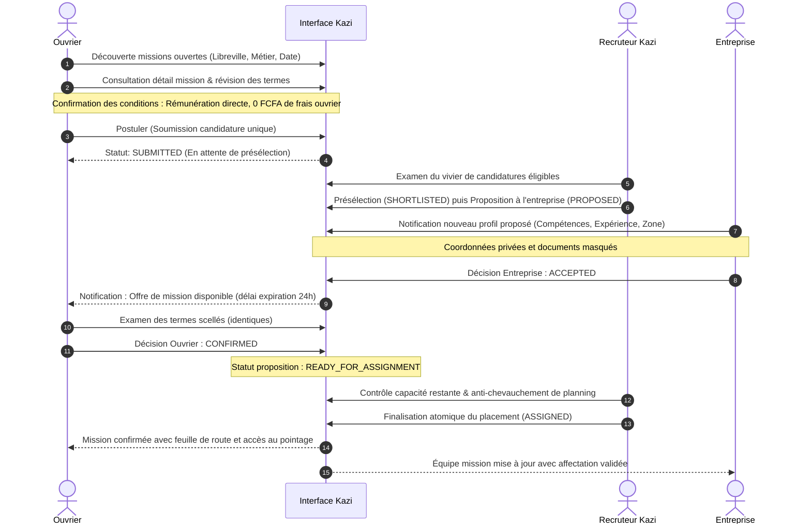
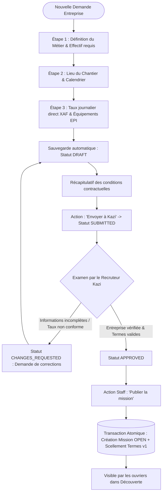
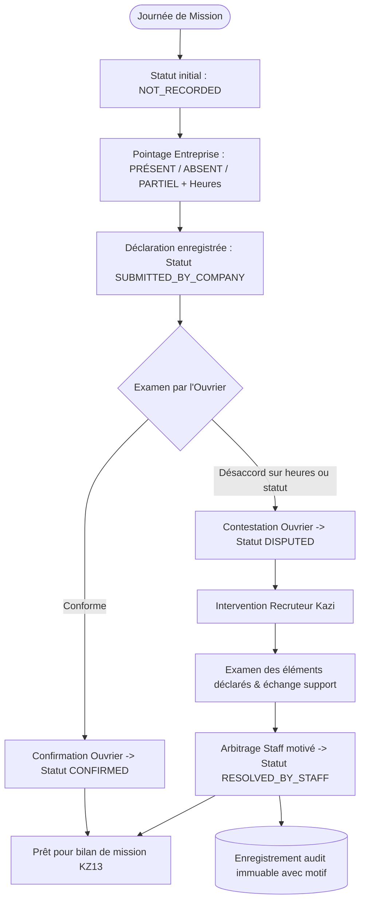
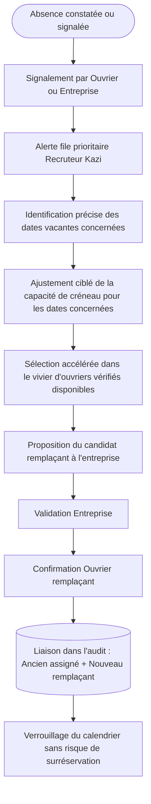

# Kazi User & Business Flow Diagrams (Phase D0a)

**Specification Edition**: 2.0.0  
**Target Release**: 1.0.0 (Gabon Launch)

---

## 1. Core Worker Journey: Apply to Final Assignment



---

## 2. Company Staffing Request to Publication Flow



---

## 3. Human Selection & Dual Confirmation Gate (Invariant KZ08 & KZ09)

```mermaid
flowchart LR
    subgraph SelectionStaff ["1. Sélection Humaine Kazi (KZ07)"]
        Pool[Vivier Candidats SUBMITTED] --> Verify[Contrôle critères éligibilité & disponibilité]
        Verify --> Shortlist[Statut SHORTLISTED]
        Shortlist --> Propose[Action Recruteur : Proposer à l'Entreprise]
    end

    subgraph DecisionCompany ["2. Décision Entreprise (KZ08)"]
        Propose --> CoView[Examen profil anonymisé]
        CoView --> CoDecision{Décision Entreprise}
        CoDecision -->|Refusé| CoDeclined[Proposition DECLINED]
        CoDecision -->|Validé| CoAccepted[companyDecision: ACCEPTED]
    end

    subgraph DecisionWorker ["3. Confirmation Ouvrier (KZ08)"]
        CoAccepted --> WNotif[Invitation Ouvrier transmise]
        WNotif --> WCountdown[Compte à rebours 24h avant expiration]
        WCountdown --> WDecision{Décision Ouvrier}
        WDecision -->|Délai expiré ou Refus| WDeclined[workerDecision: DECLINED / EXPIRED]
        WDecision -->|Accord sur termes identiques| WConfirmed[workerDecision: CONFIRMED]
    end

    subgraph AtomicFinalize ["4. Finalisation Kazi (KZ09)"]
        WConfirmed --> Ready[Statut Proposition : READY_FOR_ASSIGNMENT]
        Ready --> AdminLock[Recruteur Kazi : Verrou atomique & Contrôle capacité]
        AdminLock --> AssignmentSuccess[Création ASSIGNMENT : CONFIRMED]
    end

    style AtomicFinalize fill:#e8f4ec,stroke:#0b5d3b,stroke-width:2px;
```



---

## 4. Daily Attendance & Dispute Resolution (KZ10)



---

## 5. Worker Replacement Workflow (KZ11)



---

## 6. Theme Switching Architecture (Zero Impact on Domain Business Rules)

```mermaid
flowchart TD
    subgraph ConfigLayer ["Couche Configuration / Présentation"]
        Registry[config/registry.json] --> GAConfig[GA-1.0.0.json : Gabon Launch]
        GAConfig --> DefTheme[gabon-premium@1.0.0]
        GAConfig --> AltTheme[forest-premium@1.0.0]
        DefTheme --> TokenResolver[Injecteur de Jetons Sémantiques :root]
        AltTheme --> TokenResolver
        TokenResolver --> CSSVars[Variables CSS : --color-primary, --color-surface, etc.]
    end

    subgraph SharedComponents ["Composants UI Partagés"]
        CSSVars --> Button[Boutons, Cartes, Badges, Modales, Tables]
        Button --> MobileView[Vue Mobile 360px]
        Button --> TabletView[Vue Tablette 768px]
        Button --> DesktopView[Vue Bureau 1440px]
    end

    subgraph InvariantDomain ["Domaine Métier Immuable"]
        DomainRules["Règles Métier Stables :
        - 0 FCFA de frais ouvrier
        - Rémunération directe par l'entreprise
        - Double validation obligatoire (KZ08)
        - Finalisation atomique staff (KZ09)
        - Masquage des données privées CNI/Téléphone"]
    end

    CSSVars -.->|Présentation seule| InvariantDomain
    style InvariantDomain fill:#f7f7f2,stroke:#53645d,stroke-width:2px;
```
